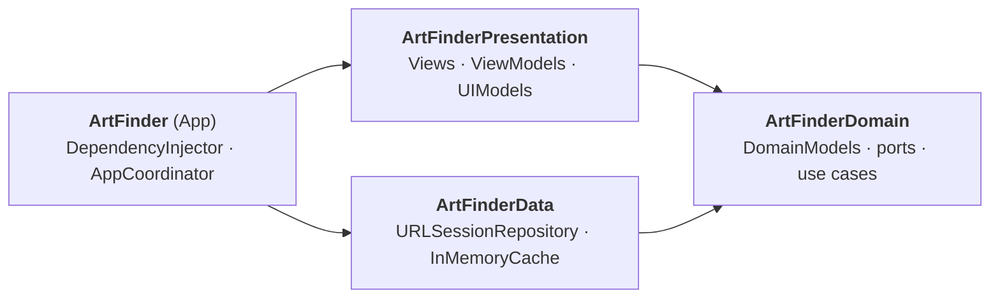

# ArtFinder

Search the **Art Institute of Chicago** collection by artist, title or style, browse the results and open the details of each artwork.

iOS technical assessment: SwiftUI, Swift 6 strict concurrency, modular clean architecture, search cancellation, time-limited caching, tests and accessibility.

## Public API

[Art Institute of Chicago API](https://api.artic.edu/docs/):

- **No API key**: the project runs as is, no setup needed.
- **Free-text search** (`GET /api/v1/artworks/search?q=…&limit=20&fields=…`), requesting only the fields the app uses.
- **IIIF images** (`{iiif_url}/{image_id}/full/{200|843},/0/default.jpg`) with **alt text written by the museum** (`thumbnail.alt_text`), used as the VoiceOver label.
- Anonymous limit of 60 requests per minute. Debouncing and caching keep usage far below it.

> **`AIC-User-Agent` header.** The docs ask for it "as a courtesy", but the image server answers **403** to requests without it (verified: only requests with the header get a 200). It's sent with every request, to both the API and the image server. Since `AsyncImage` can't add headers, images are downloaded with a dedicated loader (see [Images](#images)).

Some images may not be in the public domain.

## How to run

**Requirements:** Xcode 26 · iOS 17+.

1. Open `ArtFinder.xcodeproj`.
2. Select the **ArtFinder** scheme and an iPhone simulator.
3. Press **⌘R** to run the app and **⌘U** to run every test.

From the command line:

```bash
xcodebuild test -project ArtFinder.xcodeproj -scheme ArtFinder \
  -destination 'platform=iOS Simulator,name=iPhone 17'
```

**Demo mode (offline):** in *Edit Scheme → Run → Arguments*, enable `-useMockData`. The app then uses 5 local artworks: try `monet`, `american` or `nighthawks`. Searching for `error` simulates a connection failure. This mode is for showing the app with deterministic data, without depending on the API.

## Architecture

Clean / hexagonal architecture in a local Swift package (`ArtFinderKit`) with one module per layer, plus **MVVM-C** for presentation.



| Module | Responsibility | Depends on |
|---|---|---|
| **ArtFinderDomain** | Models (`ArtworkDomainModel`), input rules (`SearchQueryRequestDomainModel` normalizes the text and requires at least 2 characters), ports (`ArtworkRepositoryProtocol`, `ImageRepositoryProtocol`), use case (`SearchArtworksUseCase`) and `DomainError` | Nothing |
| **ArtFinderData** | Port adapters: networking (`ApiBuilder`, `Api`, `URLSessionRepository`, `URLSessionImageRepository`), decodable `DataModel`s and caching | Domain |
| **ArtFinderPresentation** | SwiftUI views, `@Observable @MainActor` ViewModels and `UIModel`s | Domain |
| **ArtFinder** (app target) | Composition root: `DependencyInjector` and coordinators | Everything |

- **Dependency rules are declared in `Package.swift` and checked in CI.** Xcode builds every module of the package into the same products folder, so an undeclared import (e.g. `import ArtFinderData` inside Presentation) can still compile locally. [`scripts/check-architecture.sh`](scripts/check-architecture.sh) fails the build when a layer imports a module it doesn't depend on (it also keeps SwiftUI and UIKit out of Domain and Data). Run it locally with `./scripts/check-architecture.sh`.
- **One model per layer:** `…DataModel` (Data) ↔ `…DomainModel` (Domain) ↔ `…UIModel` (Presentation).
  - Request DataModels are `Encodable` and are built with `init(request:)`.
  - Response DataModels convert with `parseToDomainModel()`.
  - UIModels are built with `init(domainModel:)`.
  - **Views never import Domain**: they only receive formatted UIModels. ViewModels work with Domain.
- **MVVM-C:** `AppCoordinator` (`@Observable`) holds one `NavigationItem<ViewModel>` per destination, and `AppCoordinatorView` binds them with `navigationDestination(isPresented:)`.
  - ViewModels request navigation through a protocol (`SearchCoordinatorProtocol`) and keep a `weak` reference to it, so there's no retain cycle.
  - When a screen is dismissed, `NavigationItem` releases its ViewModel.
- **Dependency injection:** `DependencyInjector` (in the app target) exposes `static` factory functions.
  - Stateful instances, which are the repositories and their caches, are shared `static let`s.
  - Every type receives its dependencies through its initializer, so all of them are testable without the injector.

### Why this architecture

| Option | Why not / why |
|---|---|
| **Views only** (state in `@State`, no ViewModel) | Fine for simple screens, but here the search screen owns real logic: debouncing, cancelling in-flight searches, discarding stale results, error and empty states. In the view it couldn't be unit tested like it is now. |
| **The Composable Architecture** | Very good for large apps with shared state, but it adds an external dependency and a lot of ceremony for two screens. |
| **MVVM-C** ✅ | ViewModels hold the logic and are tested without any UI. Navigation lives in the coordinator, so views and ViewModels don't know about other screens. Combined with Clean/hexagonal layers, the API, the cache or the UI can change without touching the rest. |

## Key decisions

### Cancellation

On every text change, `SearchViewModel` goes through these steps:

1. **Cancels the previous search `Task`.** Since `URLSession` is async, the HTTP request in flight is cancelled too.
2. **If the text isn't valid** (empty or shorter than 2 characters), goes back to the initial state.
3. **If it's valid, switches to `.loading` immediately**, so results from the previous search never stay on screen.
4. **Waits 400 ms** with `Task.sleep`, which is cancellable too: this is the debounce, so typing fast triggers a single request.
5. **Runs `try Task.checkCancellation()` before publishing.** A cancelled search that finishes anyway, with a result or an error, is discarded.

Cancellation is never shown as an error. Data turns `URLError(.cancelled)` into `CancellationError`, Domain doesn't wrap it and the ViewModel ignores it. Images load with `.task(id: url)`, so SwiftUI cancels a download as soon as its row scrolls off screen.

### Caching

`InMemoryCache<Key, Value>` is a **generic `actor`** with a time to live (TTL) and an injectable clock, so expiration is tested without real waiting.

- **Searches:** cached for 5 minutes per query (`URLSessionRepository`). The key is the normalized query, so `"Monet "` and `"monet"` share an entry.
- **A valid cached result is returned without a network call.** Once it expires, the data is fetched from the network and the cache is updated.
- **Failures are never cached.**
- **Images:** cached for 30 minutes per URL (`URLSessionImageRepository`).
- **`URLSession`'s HTTP cache is disabled**, so `InMemoryCache` is the single source of truth.

### Concurrency (Swift 6)

- Swift 6 language mode in every module, with strict concurrency checking.
- Models and protocols are `Sendable`. The cache and the test doubles are `actor`s.
- ViewModels and coordinators are `@MainActor`.
- `UseCaseProtocol<Input, Output>` uses primary associated types, so the ViewModel depends on `any UseCaseProtocol<SearchQueryRequestDomainModel, [ArtworkDomainModel]>`.

### Errors

`ApiError` (Data) → `DomainError` (Domain) → `ErrorUIModel` (Presentation), with a title, a message, an icon and a **Try again** button. Data tells apart no connection, rate limiting (429), server errors and responses it can't read.

### Images

`ImageRepositoryProtocol` (Domain) → `URLSessionImageRepository` (Data: header, cache and errors) → `ImageLoader` (Presentation), injected through the SwiftUI environment (`@Environment(\.imageLoader)`). Views know neither Domain nor Data.

### Accessibility

- **VoiceOver:**
  - Each row is a button with a single label ("title, artist, date") and a hint.
  - Images use the museum's `alt_text`, or a generic label when there isn't one.
  - The number of results is announced when a search finishes.
  - Headings are marked as headers.
- **Dynamic Type:** no fixed text sizes. The thumbnail uses `@ScaledMetric`, and at accessibility sizes the row switches to a vertical layout.
- **Visual:** semantic system colors (dark mode) and animations disabled with *Reduce Motion*.
- **Localization:** English and Spanish with a String Catalog, `snake_case` keys and plurals (`"search_results_announcement".localized(with: count)`).

## Tests

**Swift Testing**, with parameterized tests (`@Test(arguments:)`), `#require` and `#expect(throws:)`. The `ArtFinder.xctestplan` test plan enables **Thread Sanitizer** and code coverage for the three modules.

| Target | What it covers |
|---|---|
| `ArtFinderDomainTests` | Query normalization and validation. Use case with a mocked repository: returns its results, propagates errors and doesn't wrap cancellation |
| `ArtFinderDataTests` | **Cache:** valid entries, expiration and independent keys. **Repositories with `URLProtocolStub`**, which intercepts the real `URLSession` and counts requests: request and header building, cache hits without a network call, expiration, failures not cached, HTTP status and connectivity error mapping, cancellation. **`DataModel` → `DomainModel` mapping** and the demo repository |
| `ArtFinderPresentationTests` | `SearchViewModel` with a use case driven by continuations, so tests decide the order in which searches finish: **a late result or error from a cancelled search is never shown**, clearing the text cancels, debounce, retry, navigation and `weak` coordinator. **UIModels:** formatting, fallbacks (untitled artworks, missing alt text, empty fields) and error mapping |

**CI:** for every pull request against `develop` or `main`, GitHub Actions checks the layer dependencies, runs **SwiftLint** in strict mode (`.swiftlint.yml`) and then builds and runs the tests on an iOS simulator. SwiftLint also runs on every build in Xcode (Run Script phase), when it's installed.

## Git workflow

[Git Flow](https://nvie.com/posts/a-successful-git-branching-model/):

- `feature/*` branches start from `develop` and are merged back into `develop` through pull requests.
- A `release/*` branch is created from `develop` for each release and merged into both `main` (tagged with the version) and `develop`.
- `hotfix/*` branches start from `main` and are merged into both `main` and `develop`.

Every pull request must pass CI before merging.
